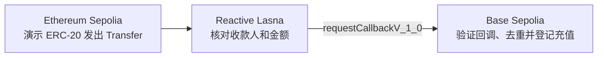

# D1 用例拆解卡：跨链记录大额测试充值

**场景**：一个应用在 Base Sepolia 上显示测试账户的充值记录，充值动作发生在 Ethereum Sepolia。大额到账时，应用需要在 Base Sepolia 上留下一条可以查询的记录。

## 1. 监听什么

源链是 Ethereum Sepolia（链 ID `11155111`）。监听部署时指定的一个演示 ERC-20 合约的 `Transfer(address indexed from, address indexed to, uint256 value)` 事件。代币约定为 18 位小数。订阅条件包含链 ID、代币地址、`Transfer` 签名和固定收款地址对应的 `topic2`。发送者可以是任意地址。

## 2. 什么时候触发

Lasna 系统合约调用 `react()` 后，检查日志来自预期的源链和代币，发送方非零地址，接收方是指定收款地址，且 `value >= 100 × 10^18`。零地址铸币和低额到账提前返回。用源链 ID、交易哈希和日志索引生成事件 ID，同一笔交易里的多条 Transfer 可以分别记录。

## 3. 在目标链做什么

通过 `requestCallbackV_1_0` 向 Base Sepolia（链 ID `84532`）的充值登记合约发起回调。登记合约同时校验目标链回调代理和 Reactive 合约地址。第一次收到事件 ID 时记录源交易、付款人、金额并发出 `LargeDepositRecorded`，重复投递直接返回。整个动作只登记事件，代币继续留在源链。

## 4. 与自己跑监听服务相比

自己部署服务时，需要持续读取源链日志，保存处理进度，处理节点断线和重连补扫，保管目标链签名密钥，管理重试并对重复事件去重。用 Reactive 后，订阅和跨链投递由网络处理，应用侧主要维护事件筛选、回调验证和登记规则。

代价是 Lasna 上的 `react()` 和 Base Sepolia 的回调各自消耗费用，并且依赖网络支持的链和投递时延。两侧合约都要维持可用资金，欠费会暂停执行。目标链仍需按事件 ID 去重，并考虑发生漏记时如何补录。

参考 [Reactive Contracts](https://dev.reactive.network/reactive-contracts)、[Callback Contracts](https://dev.reactive.network/callback-contracts)、[Origins & Destinations](https://dev.reactive.network/origins-and-destinations)。
